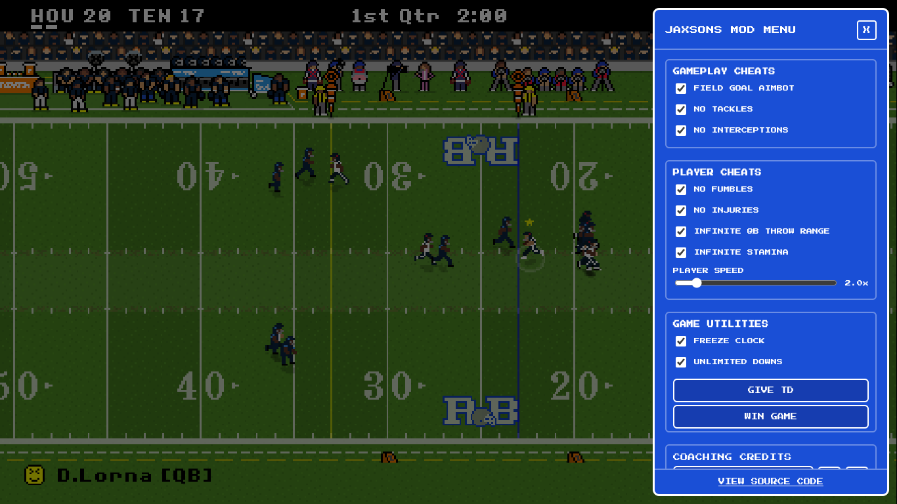

# Retro Bowl Modded

A fan made version of Retro Bowl with a built in mod menu.

## Features

- In game mod menu
- Coaching credits editor
- Salary cap editor
- Fans editor
- Roster limit control
- Draft picks for all rounds
- Facilities max / reset
- Export and import saves as JSON
- Optional starter save on first launch
- Normal free-version rules: full web version on desktop browsers, free version with upgrade reminders on phones (same as the official game)
- NFL mode: NFL team names and abbreviations, original 8-bit team badges, midfield badge and endzone names
- Real NFL rosters converted from Madden ratings (stars and potential), real players in trade offers
- Simulate your games (one at a time or automatically) from the mod menu
- Plays on iPhone: working touch controls, fills the whole screen on wide phones

## NFL mode

- New careers (and taking a new head coach job) start with your team's real starters:
  QB, RB, WR, TE, OL, DL, LB, CB, S and K - each the team's top player at that position.
- Madden overall is converted to Retro Bowl stars (97+ = 5 stars, every 4 points = half a star).
  Potential adds up to 1.5 stars for players 23 and under, less for older players, and half a
  star more for Superstar / X-Factor players under 30. Speed follows each player's Madden speed.
- Trade offers are real players from the offering team.
- Team offense / defense ratings are based on each team's real starters.
- **SIM THIS GAME** (during a game) or **AUTO-SIM MY GAMES** in the mod menu skips playing: the
  score is generated from both teams' offense / defense, like the game does for every other fixture.
- Existing saves get the new team names automatically. Use **LOAD REAL NFL ROSTER** in the mod menu
  to swap your current roster for your team's real players.

Data is generated by the scripts in `tools/nfl/`:

```bash
python3 tools/nfl/fetch_rosters.py   # refresh nfl-rosters.js from EA's current Madden ratings
python3 tools/nfl/team_ratings.py    # recompute team offense / defense in Teams.txt
python3 tools/nfl/build_logos.py     # rebuild the team logo sheet from tools/nfl/logos/<ABBR>.png
```

## Championship cutscenes

- Win your conference and an **AFC / NFC Champions** cutscene plays: celebration on the field, a
  banner in your team colours, then a "Next stop: the Super Bowl" title card.
- Win the Super Bowl and the **Super Bowl Champions** cutscene plays: final whistle under the
  lights, fireworks and confetti, then the trophy rises with your team name and season.
- Tap to skip (after 1 second). Turn them off or preview them in the mod menu under **CUTSCENES**.
- Swap the art: see **Custom art** below.

## Custom art (drop-in, no tools)

Put PNGs in the `custom/` folder and reload the game. Full sizes and team file names are in
`custom/README.txt`.

| File | Replaces | Best size |
|---|---|---|
| `custom/logos/KC.png`, `NYG.png`, `SF.png` ... | team logo everywhere (standings, match screen, midfield, cutscenes) | square, 256x256, transparent |
| `custom/trophies/super_bowl.png` | Super Bowl trophy (stage + champions screen) | portrait 3:4, 192x256 |
| `custom/trophies/afc.png`, `nfc.png` | conference trophies | portrait 3:4, 192x256 |
| `custom/field/super_bowl_field.png` | the 4 "RB" marks on the field, Super Bowl only | landscape 4:3, 192x144 |

The game has to be opened through a web server (or your host), not as a local file, for the swap to work.
Preview the Super Bowl field any time with Mod Menu > CUTSCENES > SHOW SUPER BOWL FIELD IN EVERY GAME.

## Preview



## Controls

- Click **MOD MENU** to open the mod menu
- **X** closes it
- **/** hides or shows the entire mod menu
- Apply a value, then the game reloads so changes stick

## Starter save

On first visit you can load `saves/starter.json`, a pre built save with high credits, salary, facilities, and roster content.
